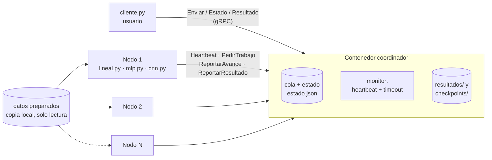

# Servidor distribuido de pipelines de entrenamiento

Proyecto final de Sistemas Distribuidos. Un **coordinador** recibe peticiones de entrenamiento
(regresión lineal, MLP o CNN, con o sin grid search), las convierte en trabajos con `job_id`
determinista, las guarda en una cola persistente y las reparte entre **nodos worker** que las piden
cuando tienen capacidad libre. Todo se comunica por **gRPC** y corre en **Docker**, solo con CPU.

> **Estado de esta entrega (esqueleto funcional).** El sistema corre de punta a punta con
> **datos sintéticos** que tienen el mismo formato que la preparación de nuScenes. La preparación
> de nuScenes (`datos/preparar_nuscenes.py`) ya corrió de punta a punta contra un nuScenes **falso**
> con el esquema de v1.0-mini (`scripts/nuscenes_falso.py`), pero **todavía no contra los datos
> reales**. Falta: correrla con nuScenes mini, medir la reducción de tiempo con 1, 2 y 4 nodos,
> llenar la bitácora y el dashboard (punto extra).
> **No hay resultados de medición en este repositorio**: cualquier número debe salir de
> `scripts/medir.sh` con los datos reales.

## Arquitectura



Flujo de un trabajo:

1. `cliente enviar` → el coordinador valida el modelo (otro tipo = `INVALID_ARGUMENT`), normaliza la
   configuración, expande el grid y calcula `job_id = sha256(modelo, config, version_datos, semilla)[:16]`.
2. Si el `job_id` ya existe, **no se crea otro trabajo**: se devuelve el existente (envío repetido).
3. Los nodos llaman `PedirTrabajo` cuando tienen un slot libre (**consumidores competidores**). El
   coordinador asigna y sube un **token de asignación**.
4. Durante el entrenamiento el nodo manda `ReportarAvance` (época, pérdida y checkpoint) y
   `Heartbeat` cada 3 s.
5. Al terminar, el nodo escribe modelo y métricas de forma atómica en local y llama
   `ReportarResultado`. El coordinador guarda **un solo resultado por `job_id`** (también atómico) y
   descarta cualquier otro que llegue después.

## Patrones de diseño

| Patrón | Dónde | Razón |
|---|---|---|
| **Coordinador con cola de trabajos** | `sistema/coordinador.py` (`Estado`, `Enviar`, `PedirTrabajo`) | Un solo lugar que conoce el estado de cada trabajo (PENDIENTE, CORRIENDO, TERMINADO, FALLIDO), genera el grid y reasigna. La cola se persiste en `estado.json` con escritura atómica en cada cambio. |
| **Health check y heartbeat** | `Nodo.latir`, `ServicioCoordinador.monitor`, `HEALTHCHECK` en los Dockerfile | Cada nodo late cada `HEARTBEAT_SEG=3` s. Tras `FALTAS_MAX=3` latidos perdidos (~9 s) el nodo queda CAÍDO y sus trabajos vuelven a la cola. Un nodo sin datos o sin bibliotecas late como "no listo" y no recibe trabajos. |
| **Timeout (plazo)** | `TIMEOUT_LINEAL/MLP/CNN` en el coordinador; `plazo=` en cada RPC (`comun.llamar`) | Plazo por trabajo según el modelo (120 s / 900 s / 1800 s por defecto) y plazo por llamada. Si vence el del trabajo, se reasigna y el nodo lento recibe la orden de cancelar en su siguiente heartbeat. |
| **Retry con backoff y jitter** | `comun.llamar`, `comun.esperar_backoff`, `Estado.devolver_a_cola` | Solo para fallas pasajeras (`UNAVAILABLE`, `DEADLINE_EXCEEDED`, ...), con espera exponencial *full jitter* y máximo de intentos. A nivel trabajo: `MAX_INTENTOS=4` y espera creciente antes de reintentar. Es seguro porque todo es idempotente. |
| **Idempotencia (`job_id`)** | `comun.calcular_job_id`, `ReportarResultado`, `comun.escribir_*_atomico` | `job_id` determinista; envío repetido devuelve el existente; un resultado por `job_id` (el segundo se descarta como `duplicado`); escritura atómica (temporal + `rename`); semillas fijas y `torch.use_deterministic_algorithms(True)`. |
| **Consumidores competidores** (recomendado) | `PedirTrabajo` con espera larga | Los nodos piden trabajo cuando están libres: los rápidos toman más y el reparto se equilibra solo, sin que el coordinador tenga que saber la velocidad de cada nodo. |
| **Bulkhead** (recomendado, ligero) | `SLOTS` y `MAX_TRABAJOS` del nodo; límites `cpus`/`memory` en compose | El nodo solo pide modelos para los que tiene slot libre (p. ej. `lineal=2,mlp=1,cnn=1`), y el contenedor tiene tope de CPU y memoria para que una CNN no tumbe al nodo. |
| **Checkpoints** (requisito de tolerancia) | `pipelines/_torch_comun.py`, `ReportarAvance` | MLP y CNN mandan su checkpoint cada época al coordinador. Si el trabajo se reasigna, el nuevo nodo continúa desde ahí. El orden de lotes depende solo de `(semilla, época)`, así que continuar da **exactamente** las mismas métricas que no detenerse (probado). |

Decisión extra: la cola entrega **primero los trabajos pesados** (`ORDEN_COLA=pesados_primero`, CNN → MLP → lineal),
la heurística LPT. Con 34 trabajos de duración muy distinta, dejar las CNN al final haría que un nodo
termine solo con una CNN larga mientras los demás esperan. Se puede comparar con `ORDEN_COLA=fifo`
como experimento propio.

### ¿Qué pasa si se cae el coordinador?

El estado completo (trabajos, peticiones, intentos, tokens) se guarda en `/estado/estado.json` con
escritura atómica después de cada cambio, y los checkpoints y resultados viven en el mismo volumen.
Compose lo reinicia (`restart: unless-stopped`). Al volver:

- los trabajos TERMINADOS siguen terminados;
- los CORRIENDO se conservan: si su nodo sigue vivo, manda heartbeat y entrega el resultado normalmente;
  si no habla en ~9 s, el trabajo vuelve a la cola;
- los nodos reintentan sus llamadas con backoff mientras el coordinador está caído y no pierden el resultado
  (lo guardan local y lo reenvían).

Limitación: el coordinador es un único punto de falla mientras está caído (no se aceptan peticiones). No se
replicó porque el enunciado solo pide explicar la recuperación.

## Estructura

```
proto/sistema/entrenamiento.proto   contrato gRPC
sistema/coordinador.py              coordinador (cola, estado, heartbeat, timeouts)
sistema/worker.py                   nodo worker
sistema/cliente.py                  CLI de usuario
sistema/comun.py                    job_id, validación, retry/backoff, escritura atómica
pipelines/lineal.py mlp.py cnn.py   plantillas con la misma interfaz ejecutar(config, semilla, dir_datos, ...)
datos/generar_sinteticos.py         datos de prueba con el formato final
datos/preparar_nuscenes.py          preparación de nuScenes (probada con nuScenes falso; falta el real)
docker/Dockerfile.nodo              imagen de nodo: Python 3.11.9, torch 2.3.1 CPU, scikit-learn 1.5.0
docker/Dockerfile.coordinador
docker/Dockerfile.datos             imagen solo para preparar nuScenes (nuscenes-devkit 1.1.11)
docker-compose.yml                  coordinador + N nodos (2 por defecto) + cliente + preparar
docker-compose.nodo.yml             nodos en otra computadora que apuntan al coordinador por IP
requirements-datos.txt              dependencias de la preparación (instalan en Python 3.11)
scripts/nuscenes_falso.py           nuScenes falso con el esquema de v1.0-mini para probar la preparación
experimentos/referencia.json        conjunto de referencia (8 + 18 + 8 = 34 trabajos)
experimentos/baseline.py            T_base y métricas de referencia (sin el sistema)
experimentos/comparar.py            compara métricas sistema vs referencia con tolerancia
experimentos/bitacora.md            plantilla de la bitácora
scripts/demo_falla.sh               inyecta una falla (docker kill a media CNN)
scripts/demo_idempotencia.sh        envío repetido
scripts/medir.sh                    tiempos con 1, 2 y 4 nodos
scripts/prueba_local.py             prueba automática sin Docker
menu.py                             menú para ejecutar todo lo anterior
```

## Formato de los datos preparados

Carpeta (por defecto `datos/generados/`), igual para datos sintéticos y reales:

| Archivo | Contenido |
|---|---|
| `version.txt` | versión de los datos; entra en el `job_id` y el nodo solo acepta trabajos de su versión |
| `particion.json` | `{"train": [escenas], "val": [...], "test": [...]}` — partición **por escena** |
| `objetos.csv` | `escena, categoria, clase, ancho, largo, alto, distancia, visibilidad, num_lidar, num_radar, velocidad` |
| `recortes.npy` | `uint8 (N, 64, 64, 3)` |
| `recortes.csv` | `indice, escena, clase` (una fila por recorte) |

Variables de entrada de lineal y MLP: `distancia, ancho, largo, alto, visibilidad` + one-hot de `clase`.
Objetivo configurable con `"objetivo"` (`num_lidar` por defecto, también `num_radar` o `velocidad`).

## Menú (la forma más corta)

```bash
python menu.py        # menú interactivo
python menu.py 4      # opción directa, p. ej. levantar el sistema
```

Solo necesita Python 3 (biblioteca estándar) y Docker. Cada opción imprime el comando que ejecuta.

| Grupo | Opciones |
|---|---|
| Datos | 1 datos sintéticos · 2 preparar nuScenes · 3 probar la preparación con nuScenes falso |
| Sistema | 4 levantar con N nodos · 5 nodos y estado · 6 conjunto de referencia (34) · 7 enviar trabajo o grid · 8 resultado de un job_id |
| Demostraciones | 9 falla (mata un nodo a media CNN) · 10 idempotencia · 11 nodo lento (timeout) |
| Medición | 12 T_base · 13 T_distribuido con 1/2/4 nodos · 14 comparar métricas |
| Otros | 15 dashboard · 16 logs · 17 apagar · 18 prueba local sin Docker |

Las opciones 1 y 2 escriben `DATOS` y `VERSION_DATOS` en `.env`, y la 4 escribe `NODOS`, así cualquier
`docker compose ...` posterior usa los mismos datos. Las opciones 9, 10 y 13 llaman a scripts de bash
(en Windows: Git Bash o WSL). La 15 avisa si todavía no hay servicio `dashboard`.

## Levantar desde cero

Requisitos: Docker con Compose v2. Nada más en la máquina anfitriona.

```bash
# 1. Datos. Mientras no estén los de nuScenes, generar sintéticos (usa la imagen del nodo):
docker compose build
docker compose run --rm --no-deps -v "$PWD/datos:/app/datos" worker \
    python datos/generar_sinteticos.py --salida datos/generados
#    Con nuScenes: ver la sección "Preparar nuScenes" (docker compose --profile datos run --rm preparar).

# 2. Levantar coordinador + 2 nodos (espera a que pasen los health checks)
docker compose up -d --wait

# 3. Usar el sistema
docker compose run --rm cliente nodos
docker compose run --rm cliente enviar lineal --config '{"tipo": "ridge", "alpha": 1}' --esperar
docker compose run --rm cliente referencia experimentos/referencia.json --esperar
docker compose run --rm cliente estado
docker compose run --rm cliente resultado <job_id>
docker compose logs -f coordinador

# 4. Más nodos / apagar
docker compose up -d --scale worker=4
docker compose down        # conserva la cola
docker compose down -v     # borra la cola y los resultados
```

Sin Docker (desarrollo): `pip install -r requirements-dev.txt` (más `torch==2.3.1`) y

```bash
bash scripts/generar_proto.sh                     # el código de gRPC no se versiona: generarlo una vez
python datos/generar_sinteticos.py
python -m sistema.coordinador                     # terminal 1
WORKER_ID=n1 python -m sistema.worker             # terminal 2
WORKER_ID=n2 python -m sistema.worker             # terminal 3
python -m sistema.cliente referencia --esperar    # terminal 4
python scripts/prueba_local.py                    # prueba automática de todo lo anterior
```

## Demostraciones

```bash
bash scripts/demo_falla.sh          # mata el nodo que corre una CNN; se reasigna y sigue desde el checkpoint
bash scripts/demo_idempotencia.sh   # mismo trabajo dos veces => un solo job_id y un solo resultado
RETARDO_POR_EPOCA=5 TIMEOUT_MLP=20 docker compose up -d   # nodos lentos => timeout y reasignación
```

## Medición de la reducción de tiempo

1. `T_base`: `docker compose run --rm --no-deps -v "$PWD/experimentos:/app/experimentos" -v "$PWD/datos:/app/datos" worker python experimentos/baseline.py --datos /datos`
   (mismo hardware, un proceso, sin el sistema). Repetirlo varias veces.
2. `T_distribuido`: `REPS=3 bash scripts/medir.sh 1 2 4` → `experimentos/mediciones.csv`.
3. `reducción(%) = (T_base − T_dist) / T_base × 100`, con promedio y desviación por número de nodos.
4. Métricas: `python experimentos/comparar.py experimentos/baseline.csv experimentos/sistema_2n_1.csv --tol 1e-6`.

Con 4 nodos de 2 CPU cada uno se necesitan 8 núcleos; en una máquina con menos, los nodos se pelean por la
CPU y la reducción se ve menor. Ajustar `cpus` en `docker-compose.yml` o medir en varias máquinas.

## Preparar nuScenes

Se corre **una sola vez** y la carpeta resultante se copia a cada computadora que tenga nodos.

Con Docker (recomendado, no instala nada en la máquina):

```bash
# La carpeta del dataset debe tener v1.0-mini/, samples/, sweeps/ y maps/
NUSCENES=/ruta/a/nuscenes docker compose --profile datos run --rm preparar
# => datos/nuscenes_mini/{objetos.csv, recortes.npy, recortes.csv, particion.json, version.txt}

# Fijar datos y versión en .env para que TODOS los comandos de compose usen lo mismo.
# Si VERSION_DATOS no está en .env, un "docker compose run cliente ..." recrea el coordinador con la
# versión por defecto (sinteticos-v1) y los nodos quedan con otra versión.
printf 'DATOS=./datos/nuscenes_mini\nVERSION_DATOS=%s\n' "$(cat datos/nuscenes_mini/version.txt)" > .env
docker compose up -d --wait
```

Sin Docker (Python 3.11): `nuscenes-devkit==1.1.11` pide `matplotlib<3.6`, que **no instala en 3.11**
(verificado: intenta compilar matplotlib 3.5.3 y falla). Por eso va sin dependencias:

```bash
pip install --no-deps nuscenes-devkit==1.1.11
pip install -r requirements-datos.txt
python datos/preparar_nuscenes.py --dataroot /ruta/a/nuscenes --salida datos/nuscenes_mini
```

Opciones de la preparación (cada decisión abierta tiene la variante del esqueleto y la del repo del equipo):

| Opción | Defecto (esqueleto) | Variante del repo del equipo |
|---|---|---|
| `--agrupacion` | `esqueleto`: bicicleta y moto en `otro` | `equipo`: todo `vehicle.*` es `vehiculo` |
| `--particion` | `nombres`: escenas ordenadas, 6/2/2 | `equipo`: permutación de tokens con `--semilla 42`, 60/20/20 (da la misma partición que `scripts/preparar_datos.py` del equipo, verificado) |
| `--camaras` | las 6 cámaras | `CAM_FRONT` |
| `--visibilidad` | `completa`: la caja entera dentro de la imagen | `parcial`: recorta la parte visible |

Las opciones quedan escritas en `version.txt`, que entra en el `job_id`: cambiar una decisión de preparación
cambia los `job_id` y no se mezclan resultados de datos distintos. `--particion archivo.json` usa la partición
que dé el profesor.

Para probar la preparación sin los datos reales:

```bash
docker compose --profile datos run --rm --entrypoint python preparar scripts/nuscenes_falso.py /salida/nuscenes_falso
docker compose --profile datos run --rm preparar --dataroot /salida/nuscenes_falso --salida /salida/prueba_prep
```

El nuScenes falso pinta cada objeto como un disco de color por clase; en la prueba, ~89 % de los recortes
tienen el color de su clase (el resto son objetos tapados por otro más cercano), lo que confirma que el
recorte cae sobre su objeto.

## Nodos en varias computadoras

El enunciado habla de "nodos conectados a la red". Con `docker-compose.yml` todo corre en una sola máquina;
para sumar computadoras de la misma red local:

```bash
# Computadora del coordinador (publica el puerto 50051)
docker compose up -d --wait coordinador
# Cada computadora extra, con la MISMA carpeta de datos preparados
COORDINADOR=192.168.1.20:50051 DATOS=./datos/nuscenes_mini NODOS=2 \
  docker compose -f docker-compose.nodo.yml up -d --build
```

O a mano con `docker run`, como en el demo del curso:

```bash
docker build -f docker/Dockerfile.nodo -t entrenamiento-nodo:1.0 .
docker run -d --name nodo1 --cpus 2 --memory 3g -e COORDINADOR=192.168.1.20:50051 \
  -v "$PWD/datos/nuscenes_mini:/datos:ro" entrenamiento-nodo:1.0
```

Mismos errores comunes que el demo del curso: el coordinador escucha en todas las interfaces (`[::]:50051`),
dentro de Docker los contenedores se encuentran por nombre solo en una red con nombre (`red-entrenamiento`),
y el puerto publicado solo hace falta para nodos de otras computadoras.

## Relación con el repo del curso

El repo del curso (`AdrianMTZVazquez/SD2026-2B`) solo trae un demo de gRPC con Docker (`1_gRPC_Docker`).
De ahí se tomó: generar el código de gRPC desde el `.proto` al construir la imagen y no versionarlo
(`.gitignore`), la red de Docker con nombre y `hostname`, y la forma de levantar contenedores a mano con
`docker run`. Lo que **no** se copió a propósito: `FROM ubuntu:latest` y `pip install` sin versión, porque el
enunciado pide versiones fijas ("versión exacta, no latest") para la imagen de nodo.

## Suposiciones (marcar y confirmar con el profesor)

1. **Variable a predecir**: `num_lidar` (la que propone el enunciado). Cambiarla es un hiperparámetro (`objetivo`).
2. **Agrupación de categorías para la CNN**: `vehiculo` (vehicle.* salvo bicicleta y moto), `peaton`
   (human.pedestrian.*), `otro` (todo lo demás). Está en `datos/preparar_nuscenes.py` y en `sistema/comun.py`.
3. **Partición por escena**: nuScenes mini ordenado por nombre, 6 train / 2 val / 2 test, salvo que el
   profesor dé un archivo (`--particion`). Debe ser la misma para todos los equipos.
4. **Visibilidad** se usa como número 1–4 (los niveles de nuScenes), no como categoría.
5. **Datos**: copia local en cada nodo (montada en solo lectura). Es la opción más simple del enunciado.
6. **Mejor configuración del grid**: se elige con la métrica de **validación**; la de prueba solo se reporta.
7. **MLP en PyTorch** (no `MLPRegressor`) para poder guardar checkpoints por época y continuar al reasignar.
8. **Tolerancia de métricas**: en las pruebas locales las métricas del sistema fueron idénticas bit a bit a las
   de la ejecución directa, con el mismo `HILOS_TORCH`. Cambiar el número de hilos puede mover los últimos
   decimales; por eso todos los nodos usan `HILOS_TORCH=2`. Tolerancia propuesta: `1e-6`.
9. **Épocas de la CNN** en `referencia.json` (15) son provisionales: ajustarlas para que cada trabajo dure ≥ 1 min
   con los datos reales.
10. Reenviar un trabajo **FALLIDO** se toma como petición explícita de reintento y lo vuelve a poner en la cola.

## Qué falta

- [ ] Correr `preparar` con nuScenes mini real y revisar conteos por clase y por partición.
- [ ] Fijar con el profesor la variable, la agrupación y la partición (las opciones ya están en `preparar_nuscenes.py`).
- [ ] Ajustar `epocas` de la CNN en `referencia.json` para que cada trabajo dure ≥ 1 min con los datos reales.
- [ ] Medir T_base y T_distribuido con 1, 2 y 4 nodos (varias repeticiones) y escribir el reporte.
- [ ] Bitácora: conjunto de referencia + 3 experimentos propios (hay plantilla con 3 propuestas).
- [ ] Punto extra: dashboard en su propio contenedor con un RPC de streaming de eventos.
